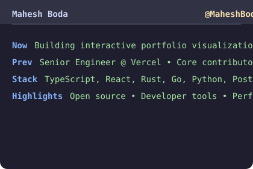

<h3><code>mahesh@github ~ $ ./contributions.sh</code></h3>

  

<h3><code>mahesh@github ~ $ whoami</code></h3>
<table>
  <tr>
    <td valign="top"></td>
    <td valign="top"></td>
  </tr>
</table>

  

<h3><code>mahesh@github ~ $ connect</code></h3>

  
  
  
  

 

<h3><code>mahesh@github ~ $ stack</code></h3>

  
  
  
  
  
  
  
  
  
  

 

<h3><code>mahesh@github ~ $ stats</code></h3>

# MaheshBoda-26
